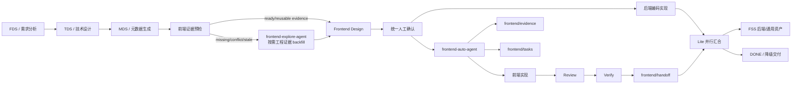

# 前后端融合执行检查清单

本清单用于 HZERO Lite 主流程与企业前端子流程在运行时核对融合边界。涉及前端交付面时，Lite、frontend-auto-agent、Frontend Design、Task、Implementation、Review、Verify 和 Handoff 都应按本清单执行分区、确认、并行、汇合和降级判断。
并行启动、前端内部多 slice 并行、共享文件锁、串行 integration task 和并发状态回写的细则，以 `front-hzero-enterprise-process-control` 的并发控制合同为准。

## 阅读路由

先看“流程总图”确认 Lite 与前端子流程连接点；需要落盘边界看“分区规则”和“必要产物”；需要并行、汇合或降级时跳到对应小节。

## 流程总图

## 分区规则

| 分区 | 路径 | 责任 |
| --- | --- | --- |
| Change Root | `sdd-workspace/changes/{change-id}/` | 统一承载 `fds.md`、`tds.md`、`mds/`、`fss/` 和 `frontend/`。 |
| 前端设计契约 | `sdd-workspace/changes/{change-id}/frontend/design/` | Frontend Design 和 Contract Check 默认产物；设计澄清、UI Contract 独立文件和 production replacement draft 仅按条件生成；与 FDS/TDS/MDS/FSS 在同一 Change Root 中参与统一确认。 |
| 前端执行资产 | `sdd-workspace/changes/{change-id}/frontend/` | Evidence、Task、Verification、Review、Handoff、Figma 缓存和最终前端交付索引。 |
| 后端/通用资产 | `sdd-workspace/changes/{change-id}/fss/` | FSS 功能摘要和后端/通用资产索引。FSS 不复制、不吸收前端执行或 Handoff 产物。 |

## 必要产物

| 阶段 | 产物 | 要求 |
| --- | --- | --- |
| Explore / Evidence | `sdd-workspace/changes/{change-id}/frontend/evidence/evidence.md` | `demo-slice`、页面交付、存在 Feature Root、后续需要复用工程事实或执行过 medium/thorough 探索时必须落盘；小范围 `regular-change`、纯问答或用户禁止落盘时可 `null + not-persisted reason`；记录目标工程、模块、Target Placement Evidence、路由入口、相似页面、包管理器、scripts 和验证命令候选。 |
| Frontend Design | `sdd-workspace/changes/{change-id}/frontend/design/frontend-design.md` | 前端技术设计和开发输入。 |
| Contract Check | `sdd-workspace/changes/{change-id}/frontend/design/contract-check.md` | 字段、API、权限、路由、LOV/lookup、附件、导入导出等契约状态。 |
| Conditional Design Artifacts | `sdd-workspace/changes/{change-id}/frontend/design/frontend-clarifications.md` / `ui-contract.md` / `production-replacement-draft.md` 或内嵌章节 | 只有存在需独立跟踪的阻塞澄清、复杂 UI Contract、mock/demo 或临时契约草稿且不适合内嵌时生成；默认不作为必须产物。 |
| Task | `sdd-workspace/changes/{change-id}/frontend/tasks/task-breakdown.md` 和 `tasks/task-status.md` | 页面交付、`demo-slice`、Feature Root、多文件、多模块或需要状态回写时必须存在。 |
| Verify | `sdd-workspace/changes/{change-id}/frontend/verification/verification-report.md` | 记录 buildable、reachable、usable 的实际证据；不能用 buildable 推导 reachable 或 usable。 |
| Review | `sdd-workspace/changes/{change-id}/frontend/review/pre-review.md` / `review/final-review.md` | production-ready、完整验收、高风险、HZERO+Choerodon 完整页面必须有 Final Review。 |
| Handoff | `sdd-workspace/changes/{change-id}/frontend/handoff/frontend-handoff.md` 和 `handoff/artifact-index.md` | 前端最终交付出口。 |
| Production Replacement | `sdd-workspace/changes/{change-id}/frontend/handoff/production-replacement-checklist.md` / `not-applicable + reason` | mock/demo 或临时契约时 required；生产契约已闭合且无待替换项时可 not-applicable；无法判断时 missing 或 blocked。 |

## 统一确认点

- TDS 人工确认后，MDS 才能生成或整理前端可用契约。
- 前端设计完成后，Lite 必须统一确认元数据、前端设计、生产契约、默认 mock demo 决策、验证范围、最终编译命令和并行开发条件。
- 影响当前 Mock demo 的 route/menu、权限码、API 契约，或是否接受与用户目标冲突的非默认条件性交付，必须回到 Lite 主流程确认。production-ready/真实 API 目标只进入后续独立集成提示，不改变当前 Mock demo。非 canonical 交付状态不得作为内部诊断或用户可接受口径。

## 并行启动条件

- 技术设计、元数据生成和前端设计已经完成。
- 人工确认通过。
- API、字段、权限、路由、菜单、LOV/lookup、附件、导入导出等共享契约已冻结或明确降级；缺少 `lovCode/lookupCode`、附件 bucket/storage/template、导入导出 templateCode、permissionCode、locale key 等参数时，只降级对应组件参数为 `generatedCandidate/mockOnly/placeholderParameter + replacement`，不阻塞并行启动。
- 涉及租户级 API、附件、导入导出、LOV/lookup 或路径含 `{organizationId}` 时，tenantContext 已按 `tenant-context-contract.md` 冻结或明确降级；缺失或冲突时不得启动 production runnable 并行实现。
- 页面打开方式已冻结或明确降级：routeOpenMode、openTab/dynamic Tab、tabTitle、dws/queryStateKey 均已 confirmed / generatedCandidate / missing 分级。
- 前端默认 mock/demo 决策和 mock 接线状态已明确。
- 后端编码实现和前端编码实现子模块都能明确执行计划、共享文件锁和集成收口条件。

## 并行汇合检查

- Lite 必须消费 `frontend-stage-result`，不得只用自然语言总结判断前端完成。
- 汇合阻塞原因对外收敛为 6 类：`question-gate`、`target-and-write-scope`、`contract-readiness`、`validator-required`、`review-blocking`、`verification-failed`。validator ruleId、owner reference gateId 和组件专项缺口只作为 evidence 明细；不得把每个 ruleId 都列成一个独立阻塞项。
- Handoff 对外说明必须把 `conditional` 缺口分为三组：`运行态未验证`（例如 `reachable=unknown`、`usable=unknown`、`manualVerificationRequired=true`）、`生产替换未闭合`（真实 API、route/menu/permission/title/i18n、LOV/lookup、导入导出、附件等 pending replacement）和 `并行汇合待判定`（后端 readiness 与前端 `mock.queryMode/contracts.productionReplacementTrigger` 的最终关系）。前两组只有在用户目标要求 production-ready / 完整验收、缺口影响当前演示路径、已授权验证实际失败、required validator 失败、Review blocking finding 或写入/契约无法形成候选时，才升级为 `blockers`；否则写入未验证项、production replacement checklist、nextStageRecommendation 和用户后续确认清单。
- `production-ready` 必须同时满足 `contractStatus=ready`、`review.status=pass`、`buildable=true`、`reachable=true`、`usable=true`、`blockers=[]`。
- 存在相似页面、历史模块、最近改动页面或项目 wrapper 复用时，`similarPageEvidenceQualityStatus` 必须为 `ready / not-applicable`，且 `legacy-risk / anti-pattern / unknown-quality` 没有进入 `adoptedPatternItems`。HZEROJS 空项目、参考资产缺失/不可读或无可采纳参考模块时，允许 `similarPageEvidenceQualityStatus=missing`，但必须同时满足 `assetBaselineStatus=active`、`assetBaselineSource=hzerojs-asset-baseline`、`assetBaselineDecision=follow-asset-baseline`、`questionGatePreservationStatus=clear`，且未采纳 anti-pattern。无来源 `UrlHistoryProvider`/页面级 Provider、单组件薄封装、`runtimeAdapters`、`buttonProps`、本地 `t()`/intl helper、非标准导入/导出入口、disabled/no-op 关键动作、`as any` 和 local-filter 伪 mock 命中时必须已被 Review/Task 标为 rejected。
- 涉及租户级 API、附件、导入导出、LOV/lookup 或 production replacement 时，`tenantContext.status` 必须为 `confirmed` 或 `not-applicable + reason`；`missing/partial/conflict/generatedCandidate` 不得汇合为 `production-ready`。
- LOV/lookup、附件、导入导出、权限、i18n 或 HZERO 通用组件只缺平台编码、参数、资产登记、相似页面、项目 wrapper 或本地样例时，不得把前端流程阻塞为 `blocked`；应保持标准组件/helper 形态，输出 `generatedCandidate/mockOnly` 参数、replacement checklist 和 Handoff 风险，最高汇合到 `conditional`，并通过 buildable/reachable/usable 说明验证事实。只有目标工程依赖/版本/编译证据明确否定标准组件可导入或可实例化且没有 confirmed wrapper、字段/value/bind 无法形成候选、写入范围不清、required validator 失败、Review blocking finding，或本轮已授权并实际执行的验证失败时，才按一级 gate 阻塞。
- HZERO+Choerodon / DataSet / Table / Form 页面涉及枚举型 props 时，`enumImportMapStatus` 必须为 `ready` 或 `not-applicable + reason`，且 `enumProvenance` 必须可追溯；`missing/partial` 不得汇合为 `production-ready`。
- `conditional` 只能作为有条件前端交付参与汇合，不得写成生产闭环。
- `usable=true` 不能建立在未评级或已标记 anti-pattern 的相似页面结构上；允许 demo 的只是契约/验证范围降级，不允许用 fake 导入导出、disabled/no-op 关键动作或本地过滤伪 mock 冒充可演示能力。
- `conditional` 必须带未验证项、`manualVerificationRequired`、前端服务提示和下一步。仅因目标前端工程未安装依赖导致依赖型验证 `not-run + blocked-by-missing-dependencies`，且 V0/Target Placement/Compliance Manifest 对账无实现阻塞时，可写 `environment-prerequisite-notice` 继续进入 Handoff 汇总，后续安装依赖后补跑；默认 `demo-slice` / mock demo 仅缺外部页面运行态证据且用户未要求 production-ready 或完整验收时，可继续进入 Handoff 汇总，不额外人工确认。非 canonical 交付状态一律不得汇合或转换。
- `blocked`、`review.status=failed` 或真实执行后的 `buildable=false` 必须阻塞汇合；无可运行目标用 `progressionDecision.blockedReason=non-runnable-target` 表达。缺依赖未执行 build 时必须保持 `buildable=unknown`，不得用 `buildable=false` 阻塞为实现缺陷。
- 未执行或默认不要求的专项测试、缺外部页面运行态证据不得作为 `verification-failed` evidence；只记录未验证项、`reachable/usable=unknown` 或 `conditional`。
- `demo-slice`、页面交付、需要状态回写的 `regular-change` 或存在 Feature Root 时，路径字段缺失且无 `null + reason`，必须回到 `frontend-auto-agent` 补齐结果合同；需要工程探索时，`evidencePath` 也属于汇合路径字段。
- 新增/改造页面的 `routeOpenMode` 缺失且无 reason 时，必须回到 Frontend Design / Task Breakdown；未确认时不得在汇合结果中声明 openTab、dynamic Tab 或浏览器新标签页已完成。

## 降级交付规则

| 状态 | 含义 | Lite 处理 |
| --- | --- | --- |
| `production-ready` | 生产契约闭合、验证和 Review 满足范围 | 可参与完整闭环汇合。 |
| `conditional` + `deliveryTarget=mock-demo` | mock/demo 目标，验证事实由 `buildable/reachable/usable` 描述 | 有条件汇合；必须引用 Handoff、未验证项和替换清单状态。 |
| `conditional` | 可运行或可演示目标存在，但关键运行/页面可用性未证明；或目标工程依赖未安装导致依赖型验证未运行 | 默认 mock/demo 或缺依赖场景不需要用户接受；若与用户要求的 production-ready、完整验收或页面运行态专项验证目标冲突，才回主流程确认。 |
| `conditional` + `contracts.backendApiReadiness.status=closed` + `implementationStatus=completed` + `runtimeAvailability=verified` + `mock.queryMode=mock-request` | 后端已有可供后续联调测试消费的运行证据，前端已完成或正在完成 Mock demo | 按 Mock demo 正常汇合，可继续 FSS/通用资产；不得自动调度 production replacement。记录 `ready-for-independent-integration` 和 nextStage。 |
| `conditional` + `implementationStatus=completed` + `runtimeAvailability=unknown/not-run` | 后端代码已落地但服务未验证可用 | 保持 mock-request，记录 `implementation-complete-runtime-unverified`、环境准备项和后续运行验证入口；不得调度 production transport。 |
| 非 canonical 交付状态 | 阶段结果合同无效 | 返回原 owning stage 重新生成 canonical 结果，不做状态转换。 |
| `blocked` | 已知阻塞或无可运行目标；无可运行目标时写 `progressionDecision.blockedReason=non-runnable-target` | 回到对应阶段修复或补契约。 |

## Blocked Placeholder 禁止规则

- 契约阻塞时不得通过生成用户可见 `BLOCKED_*`、`createBlocked*`、`功能暂不可用`、永久 disabled/no-op 操作、空操作列或 DataSet/service 抛错 transport 的页面壳来宣称前端实现完成。
- `contractStatus=blocked/partial/missing` 且缺口影响当前 Mock demo，或 Mock 接线失败时，Lite 只能补当前契约或暂停；用户要求 production-ready/真实 API 时不新增分流，完成 Mock demo 后转独立联调测试。“只保留方案澄清 / 静态骨架 / 空页面占位”不得作为继续执行选项。
- 默认 mock/demo 后，前端实现目标必须是 `deliveryTarget=mock-demo`，并明确 buildable/reachable/usable 与 production replacement checklist；不能生成 blocked placeholder。
