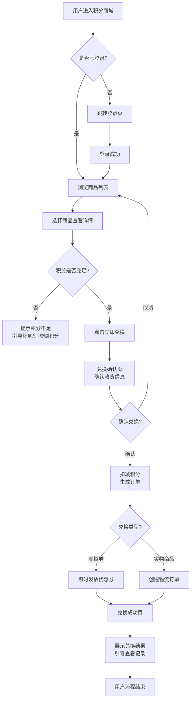
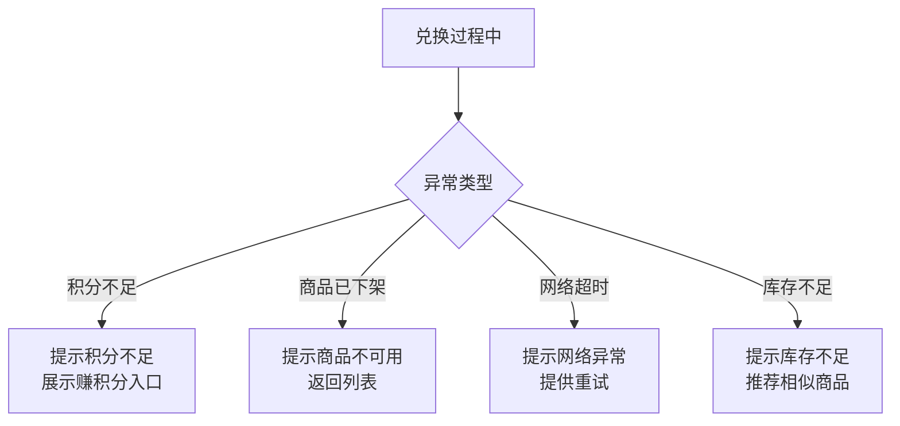

# PRD 完整结构模板（13要素）

本文件为「需求PRD到产品原型」Skill 的 PRD 生成模板。模块二生成 PRD 时读取本文件，按此结构填充。

---

## 编号规范声明（跨文件共享，必须遵守）

以下编号规范在 PRD、原型指南、原型HTML模板、SKILL.md 中保持一致：

| 编号类型 | 格式 | 示例 | 使用位置 |
|---------|------|------|---------|
| **页面编号** | `P` + 两位数字，跨模块连续，全局唯一 | P01, P02, ..., P10 | §6 Page Map、原型页面标注、对齐校验 |
| **功能编号** | `F` + 两位数字，跨模块连续，全局唯一 | F01, F02, ..., F10 | §4 功能清单、§10 验收映射表、原型功能标注 |

### 依赖标注规范

| 依赖类型 | 标注方式 | 示例 |
|---------|---------|------|
| 无依赖 | `—` | F01 依赖：`—` |
| 单依赖 | `F{编号}` | F05 依赖：`F03` |
| 多依赖 | `F{编号}/F{编号}` | F06 依赖：`F05/F01` |
| 跨模块依赖 | `F{编号}({模块名})` | F09 依赖：`F06(交易中心)` |
| 外部依赖 | `{系统/接口名}` | 依赖：`会员系统` |

---

## 模板结构（13要素·缺一不可）

```markdown
# {项目名} 需求文档（PRD）

## 1. 文档信息

### 1.1 基础信息

| 字段 | 内容 |
|------|------|
| 文档版本 | v1.0 |
| 作者 | {作者} |
| 创建日期 | {YYYY-MM-DD} |
| 状态 | 草稿 / 评审中 / 已确认 |
| 变更记录 | v1.0 初稿 |

### 1.2 需求来源追溯

| 字段 | 内容 |
|------|------|
| 需求提出人 | {姓名/角色，如"张总-运营总监"} |
| 需求来源 | 会议纪要 / 用户反馈 / 竞品分析 / 战略规划 / 产品迭代 / 其他 |
| 来源描述 | {一句话说明需求产生的背景，如"2026年Q1运营复盘会提出积分沉淀问题"} |
| 原始输入形态 | 纯文字 / 文档 / 图片 / 会议纪要 / 口述 |
| 需求成熟度 | L0点子级 / L1草稿级 / L2半成型 / L3成型 |
| 澄清轮次 | {N}轮 |
| 关键澄清记录 | {列出2-3条关键澄清结论，如"确认积分只赚不花、实物商品需物流"} |
| 相关方 | {涉及的利益相关方，如"运营部/物流部/财务部"} |

## 2. 背景与目标

### 2.1 业务背景

{为什么要做这个需求？当前痛点 / 机会 / 业务目标。引用需求澄清阶段确认的 L2 真实痛点。}

### 2.2 目标

- **业务目标**：{可量化的业务目标，如"积分消耗率从20%提升至50%"}
- **用户目标**：{用户能达成什么，如"会员可用积分兑换心仪商品"}
- **产品目标**：{产品层面的目标，如"建立积分消耗闭环，提升会员活跃度"}

## 3. 目标用户与场景

### 3.1 用户角色

| 角色 | 特征 | 核心诉求 | 权限差异 |
|------|------|---------|---------|
| {角色A} | {特征描述} | {核心诉求} | {权限说明} |
| {角色B} | {特征描述} | {核心诉求} | {权限说明} |

### 3.2 使用场景

- **场景1**：{何时何地何因使用，如"会员每日签到后查看积分余额，浏览可兑换商品"}
- **场景2**：{场景描述}

## 4. 功能需求清单

| 编号 | 模块 | 功能点 | 描述 | 优先级 | 依赖功能 | 归属页面 | 接口归属 | 备注 |
|------|------|--------|------|--------|---------|---------|---------|------|
| F01 | {模块} | {功能名} | {一句话描述} | P0 | — | P01 | {已有/新增/待评估}+接口名 | |
| F02 | {模块} | {功能名} | {一句话描述} | P0 | — | P01 | {已有}获取用户信息 | |
| F03 | {模块} | {功能名} | {一句话描述} | P0 | F01 | P02 | {已有}查询商品列表 | |
| F04 | {模块} | {功能名} | {一句话描述} | P0 | F03 | P02 | {新增}筛选商品 | |
| F05 | {模块} | {功能名} | {一句话描述} | P0 | F03 | P03 | {已有}查询商品详情 | |
| F06 | {模块} | {功能名} | {一句话描述} | P0 | F05/F01 | P04 | {新增}兑换商品+扣减积分 | |
| F07 | {模块} | {功能名} | {一句话描述} | P0 | F06 | P05 | {新增}查询兑换结果 | |
| F08 | {模块} | {功能名} | {一句话描述} | P0 | F01 | P06 | {已有}查询积分明细 | |
| F09 | {模块} | {功能名} | {一句话描述} | P0 | F06 | P06 | {已有}查询兑换记录 | |
| F10 | {模块} | {功能名} | {一句话描述} | P1 | F01 | P07 | {新增}签到+积分到账 | |

> **优先级定义**：P0=必须(MVP) / P1=重要 / P2=可延后
> **依赖功能**：该功能上线的前置条件功能（"—"表示无依赖，多依赖用"/"分隔）
> **归属页面**：对应 §6 Page Map 中的页面编号
> **接口归属**：该功能需要调用的核心接口，标注"已有/新增/待评估"+接口名称，供架构师和工程师拆分前后端任务

## 5. 用户流程

### 5.1 核心路径



### 5.2 异常路径



### Mermaid 写法规范

| 规范项 | 要求 | 示例 |
|--------|------|------|
| 图表方向 | 核心路径用 `TD`（从上到下），异常路径可用 `LR`（从左到右）区分 | `flowchart TD` |
| 节点形状 | 矩形`[]`表示动作，菱形`{}`表示判断，圆角`()`表示起止 | `A[动作]`, `B{判断?}` |
| 连线标签 | 条件分支必须标注标签 | `B -->｜是｜ E` |
| 换行 | 节点文字过长用 `<br/>` 换行 | `[扣减积分<br/>生成订单]` |
| 命名 | 节点ID用字母+数字（A/B/C或N1/N2），文字用中文 | `A[用户进入商城]` |
| 分支闭合 | 每个判断节点的所有分支都必须有去向，不能悬空 | `B -->｜是｜ E` 和 `B -->｜否｜ C` |
| 异常独立 | 异常路径单独一个 flowchart，不与核心路径混画 | 见上方5.2 |

> **流程与 Page Map 对应**：Mermaid 流程图中的每个动作节点应能映射到 §6 Page Map 中的页面。在 PRD 审查时，"流程图每个节点是否有对应页面"是完整性检查项。

## 6. 页面清单 Page Map

| 页面编号 | 页面名称 | 归属模块 | 核心功能 | 入口 | 出口 | 传递数据 | 对应功能编号 | 优先级 |
|---------|---------|---------|---------|------|------|---------|-------------|--------|
| P01 | 首页 | 积分商城 | 积分余额展示、快捷入口、热门商品 | TabBar"商城" | P02/P03/P07 | — | F01/F02 | P0 |
| P02 | 商品列表页 | 商品中心 | 商品分类筛选、列表浏览、搜索 | P01"全部商品" | P03 | 商品分类ID | F03/F04 | P0 |
| P03 | 商品详情页 | 商品中心 | 商品详情、积分价格、兑换按钮 | P02点击商品 | P04/P06 | 商品ID+积分价格 | F05 | P0 |
| P04 | 兑换确认页 | 交易中心 | 积分扣减确认、收货信息（实物） | P03"立即兑换" | P05 | 商品ID+数量+积分 | F06 | P0 |
| P05 | 兑换结果页 | 交易中心 | 兑换成功/失败反馈、查看记录 | P04"确认兑换" | P01/P06 | 订单号+结果 | F07 | P0 |
| P06 | 我的积分页 | 用户中心 | 积分明细、兑换记录 | P01"我的积分" | P01 | — | F08/F09 | P0 |
| P07 | 签到页 | 任务中心 | 每日签到、积分到账反馈 | P01"签到" | P01 | — | F10 | P1 |

### Page Map 字段说明

| 字段 | 说明 | 填写要求 |
|------|------|---------|
| 页面编号 | P01, P02... 跨模块连续编号 | 必填，全局唯一 |
| 页面名称 | 用户可感知的页面名 | 必填，简洁明确 |
| 归属模块 | 功能模块分组名 | 必填，与功能清单的"模块"列对应 |
| 核心功能 | 该页面承载的核心功能（1-3个） | 必填，对应功能编号 |
| 入口 | 用户从哪些页面/操作进入此页 | 必填，引用页面编号或"TabBar"/"外部链接" |
| 出口 | 用户从此页可以去哪些页面 | 必填，引用页面编号，多个用/分隔 |
| 传递数据 | 页面跳转时携带的关键数据 | 必填，如"商品ID"/"订单号+结果"，无传递填"—" |
| 对应功能编号 | 关联功能清单中的功能编号 | 必填，与功能清单交叉引用 |
| 优先级 | P0/P1/P2 | 必填，与功能清单一致 |

> **Page Map 与原型生成的衔接**：Page Map 是原型生成阶段的直接输入——每个 P0 页面生成一个 `.page` div，入口/出口生成页面跳转关系，核心功能决定该页面的组件配置，归属模块决定 TabBar/导航分组。

## 7. 交互说明

### 7.1 {页面A - P01}

- **入口**：{从哪进入，如"TabBar首页tab"}
- **元素**：{关键元素列表，如"积分余额卡片、快捷入口区、热门商品列表"}
- **交互**：{点击/输入/滑动后的行为，如"点击快捷入口→跳转对应页面"}
- **状态**：{默认/加载中/空数据/错误/成功}
- **数据量级**：{预计数据量：少量<20/中量20-100/大量100+；加载策略：全量/分页/懒加载；搜索策略：前端过滤/后端搜索}
- **表单验证规则**（如有表单）：
  - {字段名}：{类型}，{格式要求}，{必填/选填}，{验证时机：实时/提交}，{错误提示}
  - 示例：手机号：数字，11位1开头，必填，实时验证，"请输入正确的手机号"

### 7.2 {页面B - P02}

- **入口**：{从哪进入}
- **元素**：{关键元素}
- **交互**：{交互行为}
- **状态**：{状态说明}
- **数据量级**：{预计数据量+加载策略}
- **表单验证规则**（如有表单）：{字段+类型+格式+必填+验证时机+错误提示}

## 8. 数据要求

### 8.1 核心数据对象

| 对象 | 关键字段 | 来源 | 说明 |
|------|---------|------|------|
| {对象A，如"商品"} | {字段，如"商品ID/名称/积分价格/库存/类型"} | {来源，如"商品系统"} | |
| {对象B，如"积分账户"} | {字段，如"用户ID/当前积分/冻结积分"} | {来源，如"积分系统"} | |
| {对象C，如"兑换订单"} | {字段，如"订单号/商品ID/消耗积分/状态/时间"} | {本系统生成} | |

### 8.2 数据规则

{校验/计算/存储规则，如：
- 积分扣减：兑换时实时扣减，不足则阻断
- 积分到账：签到后即时到账，不可撤回
- 订单状态：待兑换→已兑换→已发放（虚拟）/已发货（实物）}

### 8.3 外部系统集成

> 列出本功能需要对接的外部系统、接口用途、数据流向。标注"待技术评估"的字段由架构师补充。

| 外部系统 | 接口用途 | 数据流向 | 同步/异步 | 对接状态 | 备注 |
|---------|---------|---------|-----------|---------|------|
| {如"会员系统"} | {如"获取用户信息/会员等级"} | {输入：用户ID→输出：会员信息} | {同步} | {已有/新增/待评估} | {如"已有接口，需确认字段"} |
| {如"积分系统"} | {如"扣减/查询积分"} | {输入：用户ID+积分数→输出：扣减结果} | {同步} | {新增} | {如"需新建接口"} |
| {如"商品系统"} | {如"查询商品列表/详情"} | {输入：商品ID→输出：商品信息} | {同步} | {已有} | |
| {如"物流系统"} | {如"创建物流订单"} | {输入：订单信息→输出：物流单号} | {异步回调} | {待评估} | {如"需确认是否有测试环境"} |

### 8.4 非功能性需求

> 系统化的非功能要求，架构师做技术选型时必须参考。

| 维度 | 要求 | 说明/目标值 | 优先级 |
|------|------|-----------|------|
| **性能** | 预期QPS/响应时间 | {如"核心接口QPS≤500，响应≤200ms"} | P0 |
| **可用性** | SLA目标 | {如"99.9%，故障恢复≤30min"} | P0 |
| **安全** | 数据敏感等级/加密要求 | {如"用户数据加密存储，接口需鉴权"} | P0 |
| **兼容性** | 目标端+版本范围 | {如"微信小程序基础库≥2.10，iOS12+/Android8+"} | P0 |
| **可扩展性** | 预计用户增长/数据增长 | {如"预计首月10万用户，商品数据增长≤1000/月"} | P1 |
| **合规** | 法规要求 | {如"个人信息保护法，数据不出境"} | P0 |

## 9. 非目标（Non-goals）

- ❌ 不做 {X，如"积分购买（只赚不花，不充钱）"}
- ❌ 不做 {Y，如"积分转赠（会员间不能转积分）"}
- ❌ 不做 {Z，如"跨平台积分同步"}

> 明确划出边界，防止范围蔓延。Non-goals 中的功能在原型中一律不得出现。

## 10. 验收标准

### 10.1 功能验收映射表

| 功能编号 | 功能点 | 正常流程验收 | 边界场景验收 | 异常数据验收 | 验证方式 | 优先级 |
|---------|--------|-------------|-------------|-------------|---------|--------|
| F01 | {功能名} | ①{正常条件1} ②{条件2} | {边界值：最小/最大/临界，如"积分为0时展示0"} | {异常数据：空值/超长/特殊字符} | {验证方式} | P0 |
| F02 | {功能名} | ①{条件1} ②{条件2} ③{条件3} | {边界值} | {异常数据} | {验证方式} | P0 |
| F03 | {功能名} | ①{条件1} ②{条件2} ③{条件3} | {边界值} | {异常数据} | {验证方式} | P0 |
| F06 | {功能名} | ①兑换流程正常 ②积分扣减 ③结果展示 | {边界：积分刚好等于价格/积分不足临界} | {异常：商品已下架/网络断开/库存为0} | {验证方式} | P0 |
| F04 | {功能名} | ①{条件1} ②{条件2} | {验证方式} | P0 |
| F05 | {功能名} | ①{条件1} ②{条件2} ③{条件3} | {验证方式} | P0 |
| F06 | {功能名} | ①{条件1} ②{条件2} ③{条件3} | {验证方式} | P0 |
| F07 | {功能名} | ①{条件1} ②{条件2} | {验证方式} | P0 |
| F08 | {功能名} | ①{条件1} ②{条件2} ③{条件3} | {验证方式} | P0 |
| F09 | {功能名} | ①{条件1} ②{条件2} ③{条件3} | {验证方式} | P0 |
| F10 | {功能名} | ①{条件1} ②{条件2} ③{条件3} | {验证方式} | P1 |

### 10.2 整体流程验收

- [ ] 核心路径可走通：{描述核心路径，如"签到→攒积分→浏览商品→兑换→积分扣减→收到权益/商品"}
- [ ] 异常路径有处理：{列出异常类型，如"积分不足/商品下架/网络超时 均有明确提示"}
- [ ] 所有P0功能在原型中可点击体验

### 10.3 验收标准检查清单

- [ ] 每个P0功能至少有1条正常流程验收标准
- [ ] 每个P0功能至少有1条边界场景验收（最小值/最大值/临界值）
- [ ] 关键功能有异常数据验收（空值/超长/特殊字符/非法格式）
- [ ] 每条验收标准可被验证（非"功能正常"这类模糊描述）
- [ ] 验证方式明确（页面查看/操作验证/数据对比/状态验证）

> **验收标准写法规范**：
> - **可验证**：描述具体可观察的行为（"积分展示正常"→"首页顶部显示积分数值，与用户实际积分一致"）
> - **动作链**：多步骤用①②③串联（"兑换流程可用"→"①点击兑换→②确认页展示扣减积分→③确认后积分实时扣减"）
> - **含状态**：覆盖正常/异常状态（"积分充足时按钮可点击；积分不足时按钮置灰并提示"）
> - **有量化**：有具体数值要求（"展示一些商品"→"展示≥10条商品"）

## 11. 成功指标

### 11.1 指标定义

| 指标层级 | 指标名称 | 定义 | 当前基线 | 目标值 | 衡量周期 | 数据来源 |
|---------|---------|------|---------|--------|---------|---------|
| 🎯 北极星指标 | {指标名，如"积分消耗率"} | {定义，如"已兑换积分量/已发放积分量"} | {基线，如"20%"} | {目标，如"50%"} | {周期，如"月"} | {来源} |
| 📊 核心指标 | {指标名} | {定义} | {基线} | {目标} | {周期} | {来源} |
| 📊 核心指标 | {指标名} | {定义} | {基线} | {目标} | {周期} | {来源} |
| 📊 核心指标 | {指标名} | {定义} | {基线} | {目标} | {周期} | {来源} |
| 📈 辅助指标 | {指标名} | {定义} | {基线} | {目标} | {周期} | {来源} |
| 📈 辅助指标 | {指标名} | {定义} | {基线} | {目标} | {周期} | {来源} |

### 11.2 度量计划

- 上线后 T+7：首周数据复盘，关注 {核心指标}
- 上线后 T+30：月度复盘，关注 {北极星指标} 趋势
- 上线后 T+90：季度评估，判断是否达到目标值，决定是否进入迭代优化

### 11.3 指标说明

- **北极星指标**：唯一一个"如果只看一个数字判断成败"的指标，全局对齐（1个且仅1个）
- **核心指标**：直接反映功能模块效果，用于迭代决策（3-5个，覆盖"流量→转化→留存"漏斗）
- **辅助指标**：提供诊断信息，用于定位问题（不限数量，提供诊断价值）
- **当前基线**：上线前的现状值，用于对比衡量提升效果（"—"表示暂无数据，需先建立基线）

> **北极星与需求澄清的衔接**：北极星指标须与需求澄清阶段 L3 目标价值挖掘结果直接对应。如需求澄清阶段未获取到 L3，PRD 中北极星指标标注"待确认"并给出 PM 建议值。

## 12. 风险与依赖

| 风险/依赖 | 类型 | 影响 | 应对 |
|-----------|------|------|------|
| {项，如"实物商品物流时效"} | 依赖 | {影响，如"影响兑换体验"} | {应对，如"MVP阶段仅支持虚拟券，实物延后"} |
| {项，如"积分系统接口稳定性"} | 风险 | {影响} | {应对} |
| {项} | 风险/依赖 | {影响} | {应对} |

## 13. 附录

### 13.1 术语表

{术语 / 缩写 / 定义}

### 13.2 参考资料

{竞品链接 / 行业报告 / 内部文档}

### 13.3 原型链接

{原型HTML文件路径}

### 13.4 测试要求

> 供QA工程师搭建测试环境参考。

| 维度 | 要求 | 备注 |
|------|------|------|
| **外部系统测试环境** | {如"会员系统/积分系统/商品系统 是否有测试环境可联调"} | {如"会员系统有测试环境，积分系统需Mock"} |
| **测试数据来源** | {如"造数据/Mock接口/脱敏真实数据"} | {如"商品数据造100条，用户数据用脱敏数据"} |
| **测试账号配置** | {如"普通会员账号1个+VIP会员账号1个+管理员账号1个"} | {如"账号权限按§3.1用户角色表配置"} |
| **Mock需求** | {如"物流系统未联调前需Mock异步回调"} | {如"Mock回调延迟≤3秒"} |
```

---

## 填写要点

### §1 文档信息
- **1.1 基础信息**：版本从 v1.0 开始，每次修订递增小版本号
- **1.2 需求来源追溯**：从模块一确认表直接映射——成熟度等级填入"需求成熟度"字段，矛盾裁决结果填入"关键澄清记录"字段
- **方法选择说明**：§1.2 需求来源追溯中追加"需求场景特征"字段（记录D1-D7判定结果）和"方法组合记录"字段（记录本需求使用了哪些方法，如"5W2H+5Whys+JTBD+用户故事+BPMN+高保真+走查"）。由场景诊断决定，详见 `method-selector.md`。

### §2 背景与目标
- Why 优先于 What，先讲清楚解决什么问题
- 业务背景引用需求澄清阶段确认的 L2 真实痛点

### §3 目标用户与场景
- 用户角色从模块一确认表的 WHO 维度映射
- 如有多角色，必须列出权限差异
- **方法选择说明**：D3=多角色冲突时，追加**用例图（M24）**明确角色-功能边界，识别遗漏角色；D3=单角色时保持角色表即可。由场景诊断决定，详见 `method-selector.md`。用例图详细指引见 `method-toolkit.md` M24。

### §4 功能需求清单
- **必须含优先级**（P0/P1/P2），MVP 只含 P0
- **依赖功能列**：标注功能间的前置关系，开发可据此拓扑排序
- **归属页面列**：标注功能所在页面编号，与 §6 Page Map 交叉引用

### §5 用户流程
- 核心路径用 `flowchart TD`，异常路径单独一个 flowchart
- 每个动作节点应能映射到 §6 Page Map 中的页面
- 判断节点的所有分支必须有去向，不能悬空
- **方法选择说明**：D4=复杂流程时，Mermaid flowchart 升级为**BPMN（M25）**（多角色协作+异常流）+**状态机图（M26）**（有状态流转对象如订单/工单/审批）；D4=简单时保持 Mermaid flowchart。由场景诊断决定，详见 `method-selector.md`。BPMN/状态机详细指引见 `method-toolkit.md` M25/M26。

### §6 页面清单 Page Map（新增★）
- 放在功能清单之后、交互说明之前（先有页面总览，再讲每页交互）
- P0 优先级的页面是原型生成的必须页面
- 入口/出口引用页面编号，建立页面间跳转关系网

### §7 交互说明
- 每页含入口/元素/交互/状态+**数据量级**+**表单验证规则**六个维度
- **方法选择说明**：D4=复杂业务规则时，交互说明中的规则表达升级为**决策表（M28）**穷举条件组合；D4=简单时保持文字描述。由场景诊断决定，详见 `method-selector.md`。决策表详细指引见 `method-toolkit.md` M28。

### §8 数据要求
- 核心数据对象列表+数据规则+**外部系统集成**+**非功能性需求**
- **方法选择说明**：D4=复杂数据流时，追加**数据流图 DFD（M27）**明确数据来源/加工/存储；D4=简单时保持核心数据对象列表。由场景诊断决定，详见 `method-selector.md`。DFD详细指引见 `method-toolkit.md` M27。

### §12 风险与依赖
- 风险表+依赖说明
- **方法选择说明**：D5=高不确定性时，追加**MVP验证计划**（识别核心假设→最小版本→反馈收集）；D4=复杂时追加**依赖关系图（M33）**。由场景诊断决定，详见 `method-selector.md`。MVP验证/依赖关系图详细指引见 `method-toolkit.md` M33/M46。

### §10 验收标准
- 功能点→验收标准映射表，每个 P0 功能至少1条正常流程+1条边界场景
- 验收标准用动作链（①②③）串联，覆盖正常/边界/异常状态

### §11 成功指标（新增★）
- 北极星指标 1 个且仅 1 个，与需求澄清 L3 对应
- 核心指标 3-5 个，覆盖流量→转化→留存漏斗
- 当前基线"—"表示暂无数据，需先建立基线

### §9 非目标
- 必写，是范围控制的关键
- 非目标中的功能在原型中一律不得出现

---

## 生成后自检清单（13项）

- [ ] **§1** 文档信息齐全，含需求来源追溯（1.2），需求来源三段式（类型+人+场合）
- [ ] **§2** 背景与目标已写，背景引用真实痛点
- [ ] **§3** 用户角色含权限差异，使用场景已描述
- [ ] **§4** 功能清单含"依赖功能"+"归属页面"+"接口归属"列，每个功能点有优先级
- [ ] **§5** 用户流程含 Mermaid flowchart（核心路径 TD + 异常路径），流程图节点可映射到 Page Map 页面
- [ ] **§6** Page Map 覆盖所有 P0 功能对应页面，入口/出口闭环，**传递数据**已标注
- [ ] **§7** 交互说明每页含入口/元素/交互/状态/**数据量级**/**表单验证规则**
- [ ] **§8** 数据要求含核心数据对象+规则+**外部系统集成（§8.3）**+**非功能性需求（§8.4）**
- [ ] **§9** 非目标已明确（≥1条）
- [ ] **§10** 验收标准与功能点一一映射，每个P0功能含**正常流程+边界场景+异常数据**
- [ ] **§11** 成功指标含北极星指标（1个）+ 核心指标（3-5个），北极星与目标价值对应
- [ ] **§12** 风险与依赖已列出
- [ ] **§13** 附录含术语表+参考资料+原型链接+**测试要求（§13.4）**
- [ ] 无"待确认"遗留项（或已明确标注"待确认"）

---

## PRD显式确认门禁（关卡B·PRD→原型）

PRD生成并完成13要素自检后，**强制进入"暂停等待用户显式确认"状态，禁止自动推进**。未获用户显式确认前，禁止进入交付方案选择、禁止生成原型。

### 显式确认信号识别

与全局铁律#12、`clarification-guide.md` §5.5.1 保持一致：

| 类别 | 信号示例 | 处理方式 |
|------|---------|---------|
| ✅ **白名单**（命中即推进） | 确认 / 确认通过 / 通过 / OK / 可以 / 没问题 / 同意 / 进入下一步 / 进入下一阶段 / 进入原型 / 推进 / 继续推进 / 搞定了（带确认语义） | 显式确认通过 → 进入交付方案选择（保真度+交付格式） |
| ⚠️ **灰名单**（须二次询问） | 看起来不错 / 应该可以 / 差不多 / 先这样吧 / 暂时这样 / 就这样吧 / 嗯 / 好的（语义不明时）/ 没意见 / 随便 / 你看着办 / （未回复沉默） | 二次询问："请问您是确认通过吗？A) 确认通过，进入交付方案选择 B) 还有修改（请说明） C) 其他__" |
| ❌ **黑名单**（不推进） | 修改 / 改一下 / 调整 / 不对 / 不行 / 不可以 / 等等 / 先等等 / 暂停 / 我再看看 / 让我想想 / 再考虑下 / 有问题 / 有疑问 / 不确定 | 按用户反馈修订PRD → 再次进入暂停等待状态 |

### 执行流程

1. PRD生成后，输出PRD核心要点速览（3-5条）+ PRD文件（MD/Word）
2. **进入"暂停等待用户显式确认"状态**，明确询问用户是否确认
3. 识别用户回复信号：
   - 命中白名单 → 推进至交付方案选择（保真度+交付格式）
   - 命中灰名单 → 触发二次询问，不得直接推进
   - 命中黑名单 → 按反馈修订PRD后重新等待显式确认
4. 用户提修改 → 回到模块二修订 → 修订后重新进入暂停等待状态
5. 用户未回复 → 保持暂停等待，禁止自动推进

### 关键约束

- **PRD自检通过≠可推进**：13要素自检是PRD质量门禁；显式确认是推进门禁。两者独立——自检通过后仍须用户显式确认方可推进
- **Word/MD格式降级不影响确认门禁**：即使Word生成失败降级为仅MD，确认门禁同样执行
- **违反后果**：未获显式确认即生成原型，该原型无效，必须回退至确认关卡重新等待用户显式确认

---

## Word版生成说明

PRD先按13要素模板生成 Markdown，再用 docx skill 能力将 MD 内容转为 Word 文档。

**文件命名**：`{项目名}-PRD-{日期}.docx`

**Word版格式要求**：

| 项目 | 要求 |
|------|------|
| 字体 | 正文微软雅黑，字号11pt；代码块用Consolas 10pt |
| 标题层级 | H1（§章节标题）→ 16pt加粗深蓝色；H2 → 14pt加粗深蓝色；H3 → 12pt加粗黑色 |
| 表格 | 带边框，表头行浅蓝底色加粗居中，内容左对齐 |
| Mermaid流程图 | Word中用文字流程描述替代（按步骤编号列出），或截图插入 |
| 配色 | 标题深蓝（#1F4E79）、表格表头浅蓝（#D6E4F0）、正文黑色 |
| 页边距 | 上下2.54cm，左右3.18cm（Word默认） |
| 页眉 | 文档标题 + 版本号 |
| 页脚 | 页码 |

**生成步骤**：

1. 按模板结构生成完整 Markdown PRD（13要素齐全）
2. 调用 docx skill 能力，将 MD 内容转为 Word 文档
3. 应用上述样式：微软雅黑字体、标题层级配色、表格边框、流程图文字描述化
4. 校验 MD 和 Word 内容一致性——Word 是 MD 的格式化呈现，内容不得增删

**一致性要求**：MD 和 Word 两种格式的文字内容必须完全一致，Word 仅在排版样式上做专业化呈现，不得增删或修改 MD 中的任何内容。

---

## 降级方案

如 docx skill 不可用（未安装/调用失败/超时），PRD 仅输出 Markdown 格式，跳过 Word 生成步骤。

**降级处理流程**：
1. 按模板结构生成完整 Markdown PRD（13要素齐全）——此步骤不受影响
2. 尝试调用 docx skill 生成 Word 文档
3. 调用失败/超时 → 跳过 Word 生成
4. 在 Markdown PRD 末尾追加降级说明：「> ⚠️ Word版生成失败（docx能力不可用），本次仅输出Markdown格式。如需Word格式（含专业排版），请安装docx技能后重新生成。」

**降级自检**：
- [ ] 如降级为仅MD，确认降级提示已添加在PRD末尾
- [ ] MD格式PRD的13要素内容完整性不受降级影响
